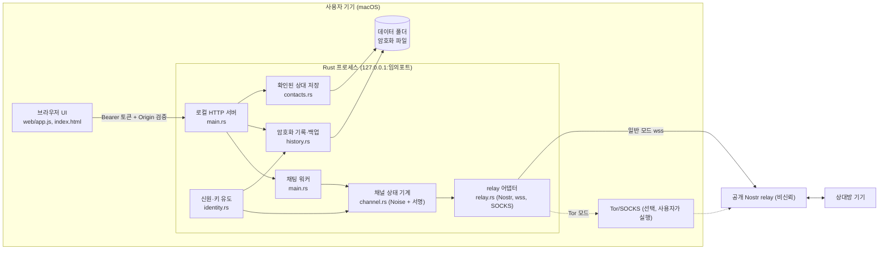
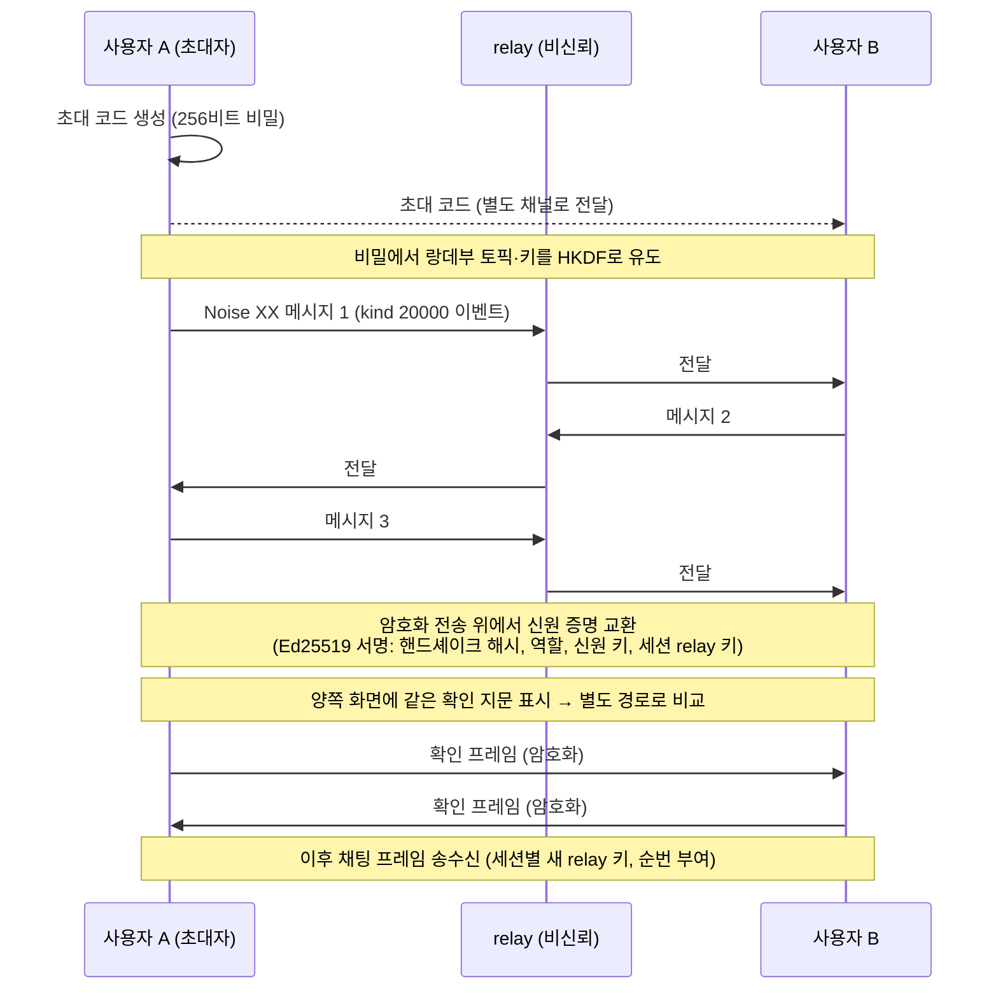
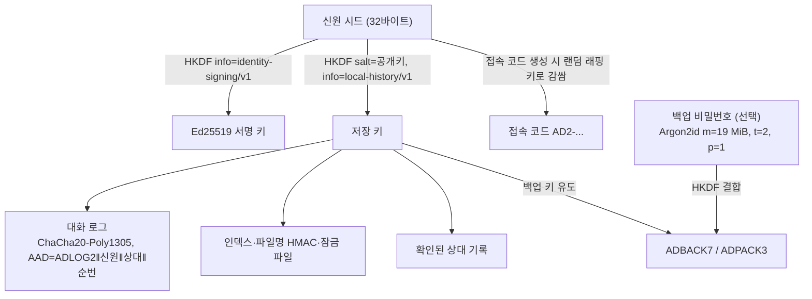

# 아키텍처

중앙 서버 없이 동작하는 로컬 1:1 텍스트 채팅입니다. 이 문서는 구성요소, 연결 흐름, 저장 구조를 코드 기준으로 설명합니다. 보안 목표와 한계는 [SECURITY.md](../SECURITY.md)를 보세요.

## 1. 구성요소

| 모듈 | 역할 |
|---|---|
| `src/main.rs` | 로컬 HTTP 서버, 연결 코드·세션 인증, API 라우팅, 채팅 워커, 설정 |
| `src/identity.rs` | 신원 시드 생성, 접속 코드(AD1/AD2) 복원, 서명 키·저장 키 유도, 신원 교체 시 데이터 복사 |
| `src/channel.rs` | Noise XX 핸드셰이크, 신원 증명, 지문 확인, 세션 프레임 순번·재정렬 창 |
| `src/relay.rs` | 초대 코드, Nostr 이벤트 송수신, 랑데부, wss/TLS, SOCKS5 |
| `src/history.rs` | 대화별 암호화 로그, 인덱스, 검색·삭제, 백업(ADBACK/ADPACK), 복원 병합 |
| `src/contacts.rs` | 사용자가 확인한 상대 관계의 암호화 저장 |
| `web/` | 프레임워크 없는 UI. 자세한 내용은 [frontend.md](frontend.md) |

## 2. 로컬 HTTP 서버의 방어

브라우저가 앱의 로컬 API를 호출하므로 다른 웹사이트의 접근을 막는 것이 첫 경계입니다.

1. `127.0.0.1`의 임의 포트에만 바인딩합니다.
2. 모든 요청의 `Host`가 `127.0.0.1:<포트>`와 정확히 일치해야 합니다 (DNS rebinding 방어).
3. 모든 POST는 정확한 `Origin`과 고정 `Content-Type`을 요구하며, 본문을 읽기 전에 검사합니다 (CSRF 방어).
4. 터미널에 출력된 256비트 일회용 연결 코드(TTL 5분, 시도 5회)로 세션 토큰을 받고, 이후 요청은 `Authorization: Bearer`로 인증합니다. 토큰은 `sessionStorage`에만 둡니다. 세션은 1시간 동안 쓰지 않으면, 어떤 경우에도 12시간이 지나면 만료되고, 새 연결 코드 발급·로그아웃·연결 해제 때 끝납니다(동시 세션은 최대 4개). 토큰이 무효이면 401, 세션은 유효하지만 신원이 로그인되어 있지 않으면 412를 돌려주므로 화면이 두 경우를 구분합니다.
5. 모든 응답(거절 포함)은 CSP(`default-src 'none'`, `script-src 'self'`, `style-src 'self'`, `frame-ancestors 'none'`), `nosniff`, `no-store`, `Referrer-Policy: no-referrer`, `Cross-Origin-Opener-Policy`·`Cross-Origin-Resource-Policy: same-origin`, `Permissions-Policy`를 포함하며 CORS 헤더는 보내지 않습니다. CSS는 `app.css`로 분리해 인라인 스타일이 없습니다. 오류 응답은 절대 경로를 파일명만 남기고 가립니다.
6. 정적 파일은 `include_bytes!`로 내장해 파일 경로를 다루지 않습니다.
7. 요청은 연결마다 별도 스레드에서 처리하며(동시 최대 16개, 넘으면 503), 헤더는 5초·본문은 30초 안에 도착해야 합니다(넘으면 408). 헤더 크기 제한(8 KiB)은 헤더에만 적용하고, `Content-Length`는 숫자만, 헤더 이름에 공백이 있으면 거부합니다. 백업 가져오기처럼 오래 걸리는 작업은 전역 락을 풀고 실행하며, 그동안 충돌하는 작업은 409로 막습니다.

## 3. 연결 흐름

핵심 성질은 다음과 같습니다.

- **신원 결속**: Noise의 static 키는 연결마다 새로 만들어지고 신원 키와 무관합니다. 신원은 핸드셰이크 해시에 대한 Ed25519 서명으로 결속되며, 이 서명은 암호화된 전송 안에서 오가므로 relay가 신원을 볼 수 없습니다. 역할 바이트가 서명에 포함되어 반사 공격을 막고, 자기 자신과의 연결은 거부합니다.
- **확인 전 차단**: typestate로 설계되어 양쪽 증명과 사용자 확인 전에는 채팅 API를 호출할 수 없습니다.
- **순번과 재정렬**: 프레임에 8바이트 순번이 있고, 32개 범위 안의 재정렬을 허용하며 중복은 무시합니다. AEAD 실패는 세션을 닫습니다.
- **재연결**: 확인된 상대와는 저장된 연락 비밀로 같은 흐름을 시작하고, 기대하는 상대 키를 고정해 지문 비교를 생략합니다.
- **전송 계층**: relay에는 암호문만 보입니다. 이벤트는 휘발성 kind 20000이며, relay가 이벤트를 수락했다는 것은 상대 수신을 뜻하지 않습니다.

## 4. 저장 구조

- **대화 로그**: 상대마다 하나의 append-only 파일입니다. 각 레코드는 인증 암호화되며 중간 레코드의 인증 실패는 오류로 처리하고, 꼬리의 불완전한 레코드만 잘라 복구합니다. 새 메시지에는 Ed25519 서명이 포함됩니다.
- **파일명**: 상대 공개 ID를 HMAC으로 변환해 디스크에 상대 ID가 드러나지 않습니다.
- **권한**: 데이터 디렉터리는 0700, 파일은 0600이며 생성 시점부터 적용합니다. 저장 위치는 릴리스 빌드(macOS)에서 사용자별 Application Support 폴더이고, 디버그 빌드는 소스 트리의 `chat-data/`입니다. 환경 변수로 바꾼 위치는 심볼릭 링크가 아니고 내 소유이며 타인 접근이 불가능한 폴더만 받습니다.
- **백업 형식**: 현재 형식은 ADBACK7(단일 대화, 스트리밍)과 ADPACK3(묶음)입니다. 형식별 보호 범위는 [README](../README.md)의 표를 보세요. 구형 형식은 읽기만 지원합니다.
- **임시 파일**: 백업 전송 작업 공간은 프로세스별 잠금(`flock`)과 manifest로 소유권을 확인한 뒤에만 정리합니다.

## 5. 알려진 구조적 한계

- `main.rs`와 `history.rs`가 각각 6천 줄 이상으로 커서 모듈 분리가 필요합니다.
- 저장 키가 일부 용도에서 같은 키로 직접 쓰이고 있어 용도별 키 분리가 필요합니다.
- 보안 한계의 전체 목록은 [SECURITY.md](../SECURITY.md#known-weaknesses)에 있습니다.
